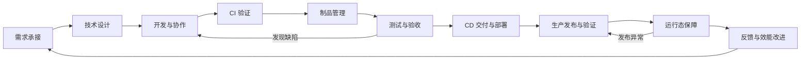

# 01｜全流程与职责地图

[返回阅读入口](README.md) · [下一章：需求与设计](02-requirements-and-design.md)

## 1. 看完整交付链，而不只看代码

本指南把功能交付拆成十个阶段，便于建立知识地图。实际工作会循环、并行：测试参与需求设计，运行要求会影响代码，生产问题也会触发新的需求。



CI 内也包含测试；图中的“测试与验收”侧重需要完整环境、跨服务协作或业务确认的验证。“CD”可以覆盖生产部署，“生产发布”单独展开，是为了看清流量、风险和结果判断。

## 2. 阶段、重点、角色与交接

下面是中等规模团队的一种常见分工。主责人负责推动结果，协作人提供专业判断或公共能力；平台接入并不转移业务团队对功能正确性的责任。

| 阶段 | 输入 → 产出 | 重点事情 | 常见主责 | 主要协作 |
|---|---|---|---|---|
| 需求承接 | 业务目标 → 可验收的需求与排期 | 范围、优先级、依赖、验收标准 | 产品负责人／业务负责人 | 业务开发、测试、项目协调者 |
| 技术设计 | 已明确的需求 → 设计与变更方案 | API、数据、兼容、容量、测试、发布和回退 | 技术负责人／业务开发 | 测试、安全、SRE、平台团队 |
| 开发与协作 | 设计 → 经评审的代码与测试 | 小批次提交、分支、评审、本地可复现 | 业务开发 | 评审人、测试、代码平台研发 |
| CI | 代码变更 → 自动验证结果和候选构建 | 编译、测试、扫描、门禁、反馈速度 | 业务开发对代码结果负责；平台团队对执行能力负责 | 测试、安全、基础设施团队 |
| 制品管理 | 成功构建 → 可定位、可追踪的制品 | 唯一标识、仓库、扫描、来源与保留 | 平台／制品仓库团队 | 业务开发、安全 |
| 测试与验收 | 指定制品与环境 → 验证证据与风险结论 | 接口、集成、回归、性能、业务验收 | 测试与业务开发共同负责质量；产品确认业务验收 | 环境平台、依赖服务团队 |
| CD | 已验证制品与部署配置 → 目标环境中的版本 | 环境、权限、配置、编排、部署状态 | 业务团队对变更负责；平台团队提供部署能力 | SRE、基础设施、安全 |
| 生产发布 | 发布计划 → 经观察和确认的生产版本 | 审批、灰度、流量、观察、停止与回退 | 明确指定的发布负责人 | 业务开发、测试、SRE、平台 |
| 运行态 | 生产服务 → 服务健康证据与事件处置 | 可观测、值班、故障、容量、SLO | 服务所属团队；依组织由开发／SRE 协同 | 平台、基础设施、依赖团队 |
| 反馈改进 | 交付与运行数据 → 可验证的改进项 | 复盘、瓶颈、开发体验、效果验证 | 业务与平台负责人共同推动 | 开发、测试、SRE、产品 |

每次发布都应该能找到业务负责人、发布负责人和异常升级路径；这些职责可能由同一个人承担，但需要明确。

## 3. 技术栈与代表性开源项目

项目名后的资料入口用于确认其定位，不代表必须全部安装。具体能力边界在各阶段章节继续解释。

| 阶段 | 需要认识的技术 | 代表性开源项目／工具 |
|---|---|---|
| 需求承接 | Issue、看板、状态流转、关联标识、API | [OpenProject](https://www.openproject.org/)、[Plane 开源版](https://plane.so/open-source)、[Gitea Issues](https://docs.gitea.com/) |
| 技术设计 | HTTP、数据库、API 契约、设计记录、图示 | [OpenAPI 生态](https://www.openapis.org/what-is-openapi)、[Mermaid](https://mermaid.js.org/intro/) |
| 开发协作 | Git、PR／MR、保护分支、Webhook、本地环境 | [Gitea](https://docs.gitea.com/)、[GitLab 开源部分](https://gitlab.com/gitlab-org/gitlab-foss) |
| CI | 流水线、DAG、Runner／Agent、构建与测试工具 | [Jenkins](https://www.jenkins.io/doc/book/pipeline/)、[GitLab CI/CD](https://docs.gitlab.com/ci/pipelines/)、[Tekton](https://tekton.dev/docs/) |
| 制品管理 | 包、OCI 镜像、Digest、SBOM、仓库 API | [Harbor](https://goharbor.io/docs/main/)、[Gitea Packages](https://docs.gitea.com/)、[Dependency-Track](https://github.com/DependencyTrack/dependency-track) |
| 测试验收 | 自动化测试、临时依赖、契约、压测 | [Testcontainers](https://testcontainers.com/)、[Pact](https://docs.pact.io/)、[k6](https://grafana.com/docs/k6/latest/) |
| CD | 容器、Kubernetes、声明式配置、GitOps、IaC | [Argo CD](https://argo-cd.readthedocs.io/en/stable/user-guide/auto_sync/)、[Helm](https://helm.sh/docs/topics/charts/)、[Ansible](https://docs.ansible.com/projects/ansible/latest/getting_started/index.html) |
| 生产发布 | 滚动、蓝绿、金丝雀、流量路由、变更控制 | [Argo Rollouts](https://argoproj.github.io/argo-rollouts/features/analysis/)、[Kubernetes Deployment](https://kubernetes.io/docs/concepts/workloads/controllers/deployment/)、[Apache APISIX](https://apisix.apache.org/docs/apisix/getting-started/README/) |
| 运行态 | Linux、网络、指标、日志、链路、告警 | [Prometheus](https://prometheus.io/docs/introduction/overview/)、[Grafana OSS](https://grafana.com/oss/)、[OpenTelemetry](https://opentelemetry.io/docs/what-is-opentelemetry/) |
| 反馈改进 | 事件关联、时间口径、数据建模、看板 | [Apache DevLake](https://github.com/apache/devlake)、[Grafana OSS](https://grafana.com/oss/) |

GitLab 的开源部分与商业功能、Grafana OSS 与云服务、Plane 开源版与商业版本需要分别看待。GitHub Actions 可作为工作中常见的托管 CI/CD 对照，本表不把 GitHub 的整体托管平台当作开源平台。

## 4. 四个容易混淆的边界

**CI 是持续集成。** 核心是频繁集成变更，并用自动化验证尽快暴露问题。有一个构建按钮不等于团队已经形成良好的持续集成实践。

**CD 可能指两件事。** 持续交付强调变更保持可发布，进入生产可保留人工决策；持续部署进一步让满足规则的变更自动进入生产。具体公司说“CD”时，需要确认指哪一种。本文的交付流程采用可保留人工生产决策的模型，工具实现参见 [Jenkins Pipeline](https://www.jenkins.io/doc/book/pipeline/) 和 [GitLab CI/CD](https://docs.gitlab.com/ci/pipelines/)。

**部署、发布、功能开放是三个可分别控制的动作。** 部署把软件放进环境并运行；发布让目标用户或流量使用新版本；功能开放还可能受功能开关控制。公司内部可能把它们都叫“上线”，平台研发需要把实际动作和成功条件拆清楚。生产策略的实现边界见 [Argo Rollouts 流量管理](https://argoproj.github.io/argo-rollouts/features/traffic-management/)。

**运行态持续存在。** 流水线结束后，还要知道用户能否成功访问、延迟是否异常、服务容量是否足够。相关方法见 [Google SRE：服务目标](https://sre.google/sre-book/service-level-objectives/)。

## 5. 贯穿各阶段的“证据链”

平台需要能回答：线上这个版本从哪里来、为什么能发布、谁发布的、上线后怎样。

```text
需求 REQ-123
  → MR-42 / Git commit
  → PipelineRun / 测试报告
  → Artifact digest / 扫描结果
  → Deployment / 环境配置版本
  → Release / 审批 / 流量变化
  → 指标 / 日志 / 事件 / 复盘
```

这是本文建议的平台领域模型，不是某款产品的统一标准。关键是使用可关联的稳定标识，避免只在页面里写一段无法追溯的文本。

## 6. 对转岗读者的优先级

最先需要解释清楚的是：一次代码提交怎样变成生产中的某个版本；每一步怎样判断成功；失败时怎样恢复。

接着学习 CI、制品、CD、发布和运行态的实际操作。最后选择一个平台模块深入设计，例如“发布单状态机＋同环境互斥＋回调幂等＋超时对账”。

自测：如果测试通过了，但生产接口一直超时，可能是哪几个阶段的哪些假设没有得到验证？阅读后续章节时持续带着这个问题。
