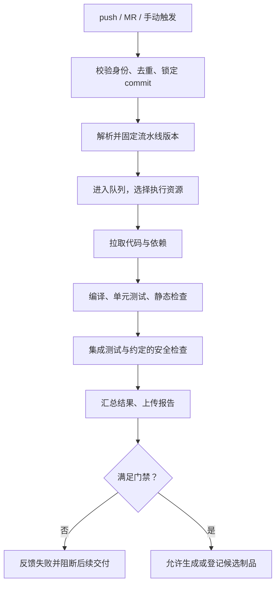

# 04｜CI：持续集成

[返回阅读入口](README.md) · [下一章：制品管理](05-artifacts-and-supply-chain.md)

## 1. 本阶段解决什么

输入是一个确定的代码版本、流水线定义和执行参数；产出是与该版本绑定的检查结果、日志、测试报告，以及允许生成时的候选制品。

持续集成强调频繁集成和及时验证。平台提供自动化执行与反馈，业务团队仍需要维护有意义的测试，并及时处理主干失败。

## 2. 谁负责

| 角色 | 主要责任 |
|---|---|
| 业务开发 | 构建与测试入口、依赖声明、业务测试、代码失败修复 |
| 测试 | 自动化场景、测试分层、失败证据、测试稳定性 |
| 安全团队 | 检查规则、风险分级、例外与修复要求 |
| 平台研发 | 触发、模板、调度、执行隔离、日志报告、状态回写和平台可靠性 |
| 基础设施团队 | 计算资源、网络、镜像与存储等底层能力，具体按组织分工 |

## 3. 一次 CI 的完整路径



这里的顺序可以调整。通常先做快且容易发现问题的检查，互不依赖的任务并行；成本高的检查按变更风险和反馈时效安排。最终候选制品要验证合并后的确定提交，不能直接把任意 MR 产物视为可信生产版本。

## 4. 先认识执行模型

| 概念 | 含义 | 平台研发关注点 |
|---|---|---|
| Pipeline Definition | 流水线定义：执行哪些任务、依赖和条件 | 版本、校验、模板升级 |
| Pipeline Run | 对某个提交的一次完整执行 | 触发来源、状态、结果、审计 |
| Job／Task | 可以调度的任务单元 | 输入输出、超时、资源、重试 |
| Step | 任务中的一个具体操作 | 命令执行、退出码、日志 |
| Runner／Agent | 真正执行任务的环境 | 标签、容量、心跳、隔离 |
| DAG | 有向无环任务依赖图 | 依赖解析、并行、失败传播 |
| Artifact | 需要保留并传递的执行产物 | 完整性、归属、访问权限 |
| Cache | 为提速而复用的内容 | 命中率、失效、污染防护 |

不同产品叫法和粒度不同。例如 [Jenkins](https://www.jenkins.io/doc/book/pipeline/) 使用 Pipeline、Stage、Step、Agent 等概念；[GitLab](https://docs.gitlab.com/ci/pipelines/) 使用 Job、Stage 和 Runner，并支持按依赖组织执行。平台的内部模型需要做清晰映射。

## 5. 一个简化的流水线例子

以下是 Java 项目中的 Jenkinsfile 教学片段：项目已提交 Maven Wrapper，Jenkins Agent 已准备兼容的 JDK，控制器已安装所需 Pipeline 与 JUnit 功能。语言不同就替换对应的构建和测试入口。

```groovy
pipeline {
    agent { label 'java-build' }
    options {
        timeout(time: 15, unit: 'MINUTES')
    }
    stages {
        stage('Verify') {
            steps {
                sh './mvnw -B verify'
            }
        }
    }
    post {
        always {
            junit testResults: '**/target/surefire-reports/*.xml',
                  allowEmptyResults: false
        }
    }
}
```

这个片段只示意“运行验证＋收集单元测试报告”。它没有实现本章其余平台能力，也未自动收集所有集成测试报告。项目若使用 Failsafe 等工具，需要追加对应报告路径并确认 `verify` 确实执行了测试。

关键是失败要向上传播：不要为了让流水线变绿，在测试命令后附加忽略错误的逻辑。报告缺失也需要有明确含义，避免“根本没跑测试”被展示成测试成功。

## 6. 质量门禁怎样定义

质量门禁是进入下一步的条件，可以包含：

- 编译和必选测试成功。
- 代码与依赖检查达到团队规则。
- 必需的评审已完成，且对应当前提交。
- 制品来源、扫描与签名满足发布要求。
- 测试报告存在且可追溯。

规则应版本化，并记录阻断原因。覆盖率是辅助证据，不能单独代表质量；对支付、权限、幂等等关键行为，有意义的测试比追求统一百分比更重要。

对历史存量问题，可以区分新增风险与已有风险。允许例外时应绑定审批、理由、范围和过期时间，避免永久绕开规则。

## 7. 平台后端真正难在哪里

### 7.1 调度与资源

排队慢、执行慢、拉取依赖慢是不同问题。先把时间拆开，再决定是增加 Agent、优化依赖下载，还是调整任务并行。

需要理解资源配额、租户公平性、任务标签、执行超时和孤儿任务回收。对外暴露“等待资源”比一直显示“执行中”更有用。

### 7.2 状态与恢复

教学状态可以是：

```text
CREATED → QUEUED → RUNNING → SUCCEEDED / FAILED / CANCELED
```

还需记录外部任务 ID、执行尝试、心跳和最后对账时间。Runner 断连时，任务结果可能未知；先查询和对账，再决定是否重试。外部任务已完成但平台没收到回调，与任务从未执行，是两种情况。

创建外部任务前保存内部运行与尝试 ID，并尽量让外部任务携带可查询的关联标识。若创建响应丢失，仍需要有定位任务的方法；外部系统不提供可靠关联时，应保留结果未知并人工核对。

取消请求也不等于任务已停止。平台要区分“用户请求取消”和“执行器已确认停止”，并说明哪些副作用已经发生。

### 7.3 重试与幂等

网络暂时不可用可以有限重试；编译错误、业务断言失败通常需要修复。对不稳定测试，应保留首次失败与重试结果并推进治理。

构建、上传、登记制品可能有副作用。每次重试都应有明确的尝试 ID，并保证重复回调不会重复创建制品或触发发布。

### 7.4 执行隔离与凭据

构建任务会运行仓库中的代码，因此要明确代码信任边界。外部贡献的 MR、普通分支和受保护分支不应默认获得相同凭据。

执行环境应按风险隔离，凭据按任务和环境最小化授予。日志需要避免泄露密钥；平台不能仅靠界面隐藏来保护后端资源。

### 7.5 缓存与可复现

依赖缓存可以提速，但缓存命中不代表内容可信或构建正确。缓存键要考虑依赖声明、运行时和架构等差异；不可信任务不能随意覆盖可信任务使用的缓存。

依赖版本、基础镜像、构建工具和网络来源也会影响输出。记录 commit 只是来源追踪的一部分。

## 8. 技术栈与代表性开源项目

| 层面 | 技术／工具 | 学习重点 |
|---|---|---|
| 自动化引擎 | [Jenkins](https://www.jenkins.io/doc/book/pipeline/) | Agent、Pipeline、共享库、插件集成 |
| 一体化代码与 CI/CD | [GitLab CI/CD](https://docs.gitlab.com/ci/pipelines/) | YAML、Runner、MR 关联；区分版本和套餐能力 |
| Kubernetes 原生流水线 | [Tekton](https://tekton.dev/docs/) | Task、Pipeline、执行资源和控制器模型 |
| 项目验证 | Maven／Gradle、Go test、pytest 等 | 掌握自己语言的一套工具即可 |
| 平台后端 | HTTP、关系数据库、队列、对象存储、容器 API | 异步、幂等、状态、权限和可靠集成 |

选择一个引擎做练习即可。Jenkins、GitLab CI 和 Tekton 都可以覆盖部分交付流程，CI 与 CD 的划分来自工作目的，不取决于工具名称。

## 9. 核心技能与验收标准

| 深度 | 本章应掌握 |
|---|---|
| 理解 | 提交怎样触发执行；定义与运行的区别；测试结果怎样绑定提交 |
| 使用 | 配置一条流水线，读取日志和报告，区分代码、环境和平台失败 |
| 开发平台 | 仓库接入、DAG 调度、执行器适配、日志报告、幂等与状态对账 |

本案例应留下 commit、流水线定义版本、运行 ID、任务耗时、测试报告和失败原因。刻意让一个权限测试失败，验证是否确实阻断后续交付。

自测：有人说“流水线偶尔失败，自动重跑直到成功就行”，你会从测试稳定性、结果可信度和副作用三个方面怎样回应？

## 官方资料

- [Jenkins Pipeline](https://www.jenkins.io/doc/book/pipeline/)：执行概念与代码化流水线。
- [Jenkins Pipeline Syntax](https://www.jenkins.io/doc/book/pipeline/syntax/)：上例所用语法与行为。
- [Jenkins JUnit Step](https://www.jenkins.io/doc/pipeline/steps/junit/)：报告收集和缺失报告的处理。
- [GitLab Pipelines](https://docs.gitlab.com/ci/pipelines/)：任务、阶段、Runner 和不同流水线类型。
- [GitLab Pipeline Security](https://docs.gitlab.com/ci/pipeline_security/)：凭据与不可信代码的边界。
- [Tekton Docs](https://tekton.dev/docs/)：云原生流水线模型。
