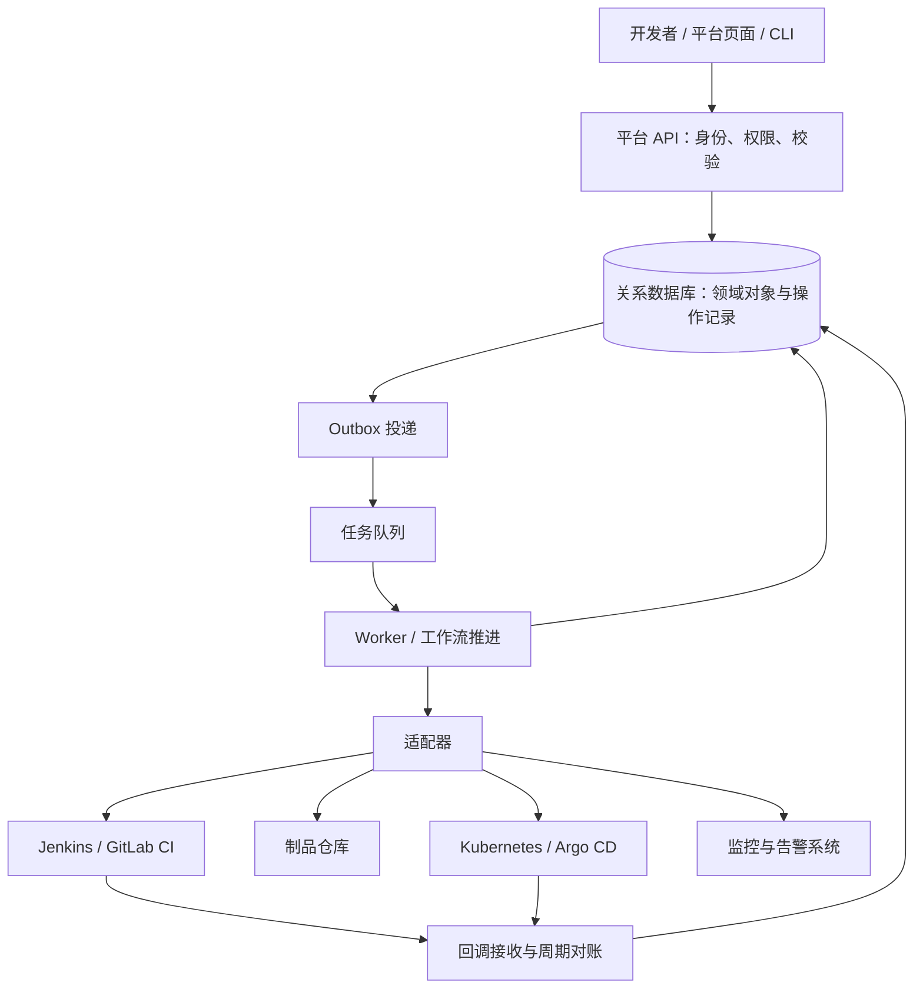

# 11｜研发效能平台后端到底开发什么

[返回阅读入口](README.md) · [下一章：转岗路线与面试](12-learning-and-interview.md)

## 1. 从熟悉的服务端开发理解岗位

如果把订单服务的业务对象换成应用、流水线、制品、环境和发布单，就能看到很多熟悉的工作：建模、API、数据库、权限、队列、状态机、外部集成和运维。

平台研发还要理解外部执行系统的语义：任务接收、部署完成、流量切换和用户恢复并不是同一件事。最大的学习增量，是把这些交付领域知识转化为可靠的软件行为。

## 2. 可能承担的模块

| 模块 | 常见开发任务 | 核心技术点 |
|---|---|---|
| 应用与服务目录 | 服务接入、负责人、仓库、依赖、环境入口 | 元数据、关系建模、权限、同步 |
| 代码集成 | Webhook、MR 检查、分支与评审规则 | 验签、幂等、事件映射、API 限流 |
| 流水线平台 | 模板、任务编排、执行资源、日志与报告 | DAG、队列、调度、隔离、状态 |
| 制品平台 | 仓库适配、扫描、证据和晋级 | 摘要、元数据、一致性、访问控制 |
| 环境平台 | 创建环境、配置、资源与回收 | Kubernetes／主机编排、配额、生命周期 |
| 发布平台 | 审批、部署、灰度、回退与审计 | 状态机、并发互斥、策略和恢复 |
| 运行与效能集成 | 告警、发布关联、诊断、过程与结果指标 | 时间线、数据口径、可观测 API |

一个职位往往只负责其中部分模块。JD 同时罗列很多工具时，要问清实际主线、团队分工和已有底座。

## 3. 一种教学架构



这是一种可选的设计模型，具体团队可能用工作流引擎、控制器、事件总线或模块化单体实现。初学时先建立对象与恢复机制，系统规模上来后再决定是否拆微服务。

API 负责快速接受请求；Worker 做耗时操作；回调和周期对账共同修正平台对外部状态的认识。

## 4. 关键领域对象

| 对象 | 关键字段示意 |
|---|---|
| Application | ID、仓库、负责人、租户、技术栈 |
| Environment | 类型、资源范围、配置引用、访问策略 |
| PipelineDefinition | 内容、版本、模板版本 |
| PipelineRun | commit、定义版本、触发源、状态、外部 ID |
| Artifact | 完整摘要、来源运行、平台架构、证据 |
| TestRun | 制品、环境、用例版本、报告、结果 |
| Deployment | 目标输入、环境、执行状态、实际观测 |
| Release | 制品与配置快照、策略、审批、发布阶段 |
| ExecutionAttempt | 步骤、尝试号、外部 ID、开始结束、结果 |
| AuditEvent | 操作者、动作、输入摘要、原因、结果、时间 |

表结构并不需要一开始完全照搬；关键是区分定义和执行、期望和实际、用户意图和执行结果。

## 5. 设计一个发布 API

教学接口：

```http
POST /api/releases
Idempotency-Key: request-20261016-001
```

```json
{
  "applicationId": "order-service",
  "environmentId": "staging",
  "artifactId": "artifact-123",
  "configurationRevision": "config-42",
  "strategyRevision": "rolling-v2"
}
```

一个可靠的接收流程：

1. 验证身份、租户、应用和环境权限。
2. 规范化业务参数并计算请求指纹，在确定的权限范围内查询幂等键。
3. 同一键、同一请求返回已有记录；同一键、不同内容返回冲突。
4. 仅对新请求固定制品、配置与策略输入，检查证据与当前门禁。
5. 原子创建发布记录与待发事件，并处理幂等键竞争和同环境并发。
6. 返回发布 ID 和查询入口；异步推进并记录步骤。

可以返回 `202 Accepted` 表达任务已接受，但它不能表示发布成功。客户端通过查询接口或事件订阅获取后续结果。

注意：幂等键的作用域、有效期和请求指纹要明确。调用者没有权限时，即使猜中已有幂等键，也不能读取别人的发布结果。

查重应先于可变门禁检查。某个发布已被接受，客户端因超时重复请求，此时审批或扫描证据可能已经过期；重复请求应返回既有记录，而非重新创建或丢失原结果。任务开始执行或正式放量前是否再次检查门禁，由执行规则另行决定并记录。

## 6. 六个高频工程难点

### 6.1 外部成功，平台未知

网络超时后，Kubernetes 或 Jenkins 可能已执行操作。已获得外部 ID 时保存它并查询真实状态，必要时进入待对账状态。

最难的情况是外部已经创建成功，但包含 ID 的响应丢失。调用前应持久化内部操作 ID，并尽可能通过确定性资源名、标签、外部幂等令牌或可查询关联字段定位结果。选择方法时要验证外部系统实际支持的查询与一致性语义。

如果外部系统既不支持幂等创建，也无法可靠查询对应结果，应保留“结果未知”，提供人工核对与受控恢复路径。对账机制不能凭空恢复外部系统没有暴露的证据。

### 6.2 数据库写入成功，队列投递失败

可采用事务性 Outbox：数据库事务同时保存领域对象与待发事件；投递器重试发送；消费者幂等处理。消息重复不应导致重复发布。

### 6.3 同时发布同一环境

锁应覆盖相应业务边界，且执行期间可能超时或失联。只加一个 Redis 锁不足以解释所有正确性问题，还应考虑唯一约束、租约、操作版本和旧执行者写入。

可以用乐观锁限制状态迁移：

```sql
UPDATE release_run
SET state = :new_state, version = version + 1
WHERE id = :id
  AND state = :expected_state
  AND version = :expected_version;
```

这是 SQL 设计示意。检查影响行数；更新未生效时重新读取和判断，不能继续假设自己拥有推进权。

### 6.4 回调乱序

旧尝试的失败回调，不能把新尝试已经成功的状态改回失败。校验运行 ID、尝试号、资源版本及允许迁移；终态更正需要显式规则和审计。

### 6.5 取消与回退

取消 API 是一个意图。Worker 可能正在执行，外部控制器也可能持续推进。需要停止后续调度、确认外部状态、收敛期望配置，再判断是否完成或需要人工处理。

### 6.6 多租户与凭据

所有对象访问都需要按租户和资源授权；查询、下载日志、重试、回退都要校验。执行身份按环境授权，秘密值避免进入数据库普通字段、日志和制品。

## 7. 日常工作是什么样

以下是一组教学工作事项，用于帮助理解岗位：

- 接入一个新的代码平台，把仓库与应用自动关联。
- 优化任务列表，让开发者看清排队与执行时间。
- 修复重复 Webhook 导致的重复任务。
- 为发布增加数据库变更提示与审批证据。
- 排查“平台超时但集群已经更新”的状态不一致。
- 实现临时环境过期回收，并处理回收失败。
- 把发布标记写入观测系统，缩短排查路径。
- 采访接入团队，减少首次接入需要填写的配置。

平台自身也需要测试、CI/CD、可观测、值班和容量管理。平台研发会成为自己产品的使用者。

## 8. 与相邻岗位的常见区别

| 岗位侧重 | 主要工作对象 | 面试需要确认的边界 |
|---|---|---|
| 业务后端 | 用户与业务流程 | 是否同时承担发布、值班和运行质量 |
| 研发效能平台后端 | 交付流程与开发者服务 | 自研模块、集成深度、服务规模 |
| SRE | 生产服务的可靠性与工程治理 | 值班、容量、故障、自动化和代码比例 |
| 基础设施／容器平台 | 计算、网络、存储与集群 | 是否深入调度、运行时和控制器 |
| DevOps 工程岗位 | 名称覆盖范围很广 | 是平台研发、交付集成、基础设施还是运维自动化 |

这是一种沟通分类，真实岗位会交叉。不能只根据“DevOps”标题推断日常工作。

## 9. 代表性开源项目怎么读

| 项目 | 适合观察的对象 | 主要学习价值 |
|---|---|---|
| [Backstage](https://backstage.io/docs/features/software-catalog/) | 服务目录与元数据 | 认识开发者门户和服务入口；它不自动实现全部交付控制 |
| [Jenkins](https://www.jenkins.io/doc/book/pipeline/) | 执行器与流水线集成 | 任务执行和平台适配 |
| [Argo CD](https://argo-cd.readthedocs.io/en/stable/user-guide/auto_sync/) | 期望与实际状态 | 声明式交付和持续对账 |
| [Argo Rollouts](https://argoproj.github.io/argo-rollouts/features/analysis/) | 发布过程与分析 | 渐进控制和结果判定 |

先选与自己模块相关的 API、领域对象和失败路径阅读。无需一开始通读所有源码。

## 10. 核心能力

已有后端经验继续保持：API 与数据建模、事务、队列、并发、测试、权限、可观测与可靠外部集成。

新增领域能力重点补齐：CI 执行模型、制品身份、部署状态、发布策略、环境配置、运行反馈。

自测：设计“重试发布”时，是重跑失败步骤、重新执行整次发布，还是创建新发布？分别需要满足什么条件？能回答清楚，比增加一个重试按钮更接近平台研发。
